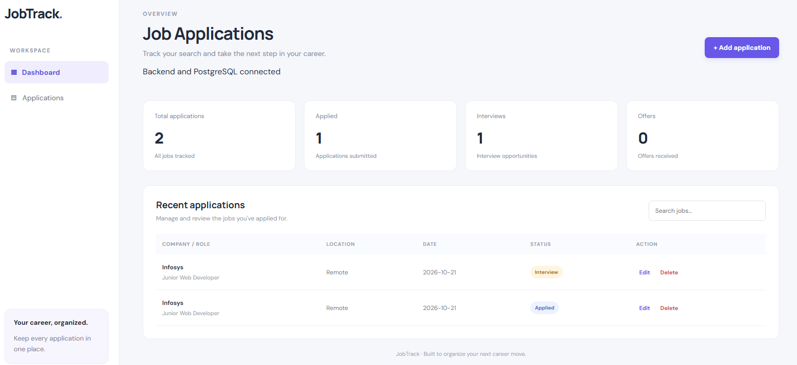

# JobTrack — Job Application Tracker

A full-stack web application to organize job applications, track application statuses, and manage your job search in one place.

## Application Preview



## Features

- Add, view, edit, and delete job applications
- Search by company, job title, or location
- Track application statuses: Applied, Interview, Offer, and Rejected
- Dashboard statistics for applications, interviews, and offers
- PostgreSQL database persistence
- REST API built with Express.js
- Responsive React dashboard

## Tech Stack

**Frontend**
- React
- Vite
- JavaScript
- CSS
- Axios

**Backend**
- Node.js
- Express.js
- PostgreSQL
- node-postgres (`pg`)
- dotenv

## Project Structure

```text
job-application-tracker/
├── backend/
│   ├── db.js
│   ├── schema.sql
│   ├── server.js
│   ├── test-db.js
│   └── package.json
├── frontend/
│   ├── src/
│   │   ├── api/
│   │   ├── App.jsx
│   │   └── App.css
│   └── package.json
├── .gitignore
└── README.md
```

## Getting Started

### Prerequisites

Install Node.js, npm, PostgreSQL, and Git.

### 1. Clone the repository

```bash
git clone https://github.com/rahimsyed446-hue/job-tracker-application.git
cd job-tracker-application
```

### 2. Create the database

Create a PostgreSQL database named `jobtrack`.

Run the SQL in `backend/schema.sql` against that database using pgAdmin or the PostgreSQL command line.

### 3. Configure and start the backend

```bash
cd backend
npm install
```

Create a `backend/.env` file with your local database settings:

```dotenv
DB_HOST=localhost
DB_PORT=5432
DB_NAME=jobtrack
DB_USER=postgres
DB_PASSWORD=YOUR_LOCAL_POSTGRES_PASSWORD
```

Replace the password placeholder with your own PostgreSQL password. Never upload your real `.env` file to GitHub.

Start the backend:

```bash
node server.js
```

The API runs at `http://localhost:5000`.

### 4. Start the frontend

Open a second terminal from the project root:

```bash
cd frontend
npm install
npm run dev
```

Open the local URL printed by Vite, usually `http://localhost:5173`.

## API Endpoints

| Method | Endpoint | Description |
|---|---|---|
| GET | `/api/health` | Check backend and database connectivity |
| GET | `/api/applications` | Get all applications |
| POST | `/api/applications` | Create an application |
| PUT | `/api/applications/:id` | Update an application |
| DELETE | `/api/applications/:id` | Delete an application |

## Security

- Keep `.env` files private.
- Never commit database passwords or credentials.
- Keep `node_modules` out of Git.
- Use your own database credentials when running locally.

## Future Improvements

- User authentication
- Live deployment
- Application reminders
- Charts and advanced filtering

## Author

**rahimsyed446-hue**

GitHub: https://github.com/rahimsyed446-hue
